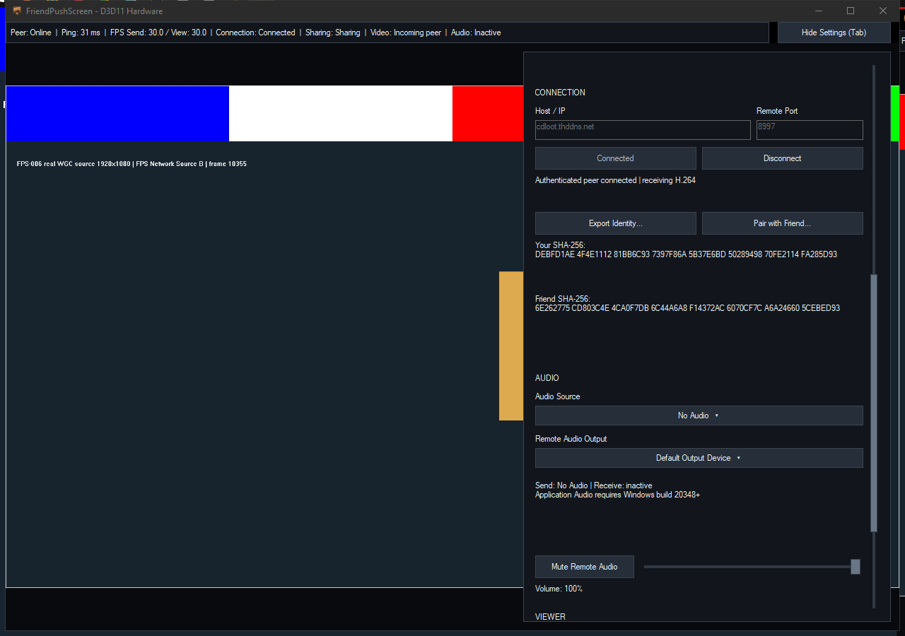
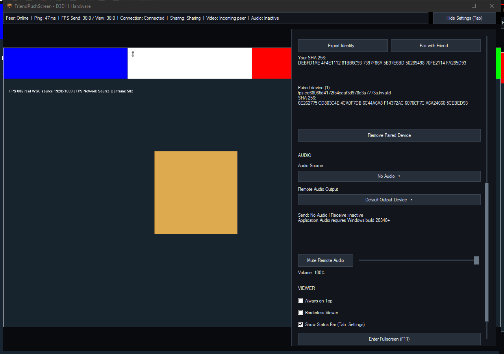
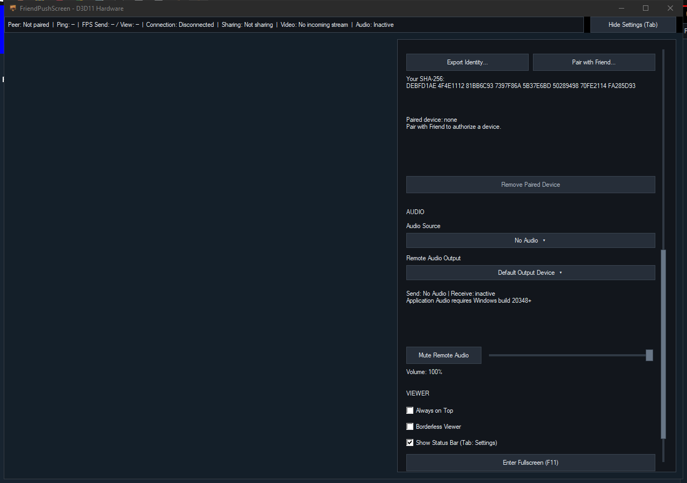

# Native Host/IP routes and saved-device removal — 2026-10-17

## Result and scope

A single Host / IP and Remote Port now covers IPv4 localhost/LAN, DNS/DDNS and the OS-routed IPv4 Tailscale address. The obsolete Connection Mode chooser is removed. The existing one saved paired device appears with its stable certificate identity and full fingerprint. Remove Paired Device stops the session and deletes its persistent authorization; the local DPAPI identity and ordinary settings are preserved. Re-pairing still requires explicit confirmation of the complete public fingerprint.

Qualified on CDQ-P, Windows 10 22H2 build19045 x64, Core Ultra5 245K/iGPU,14 logical CPUs. Distinct portable folders use A8996→B8997 and B8997→A8996. The actual DDNS name was cdloot.thddns.net. All routes below return to this one physical PC. This is self-LAN/public-name NAT-loopback/own-Tailscale-address evidence; physical second-PC WAN or overlay routing is untested.

## Source and implementation

| Increment | Exact source | Release executable SHA256 |
|---|---|---|
| Unified IPv4/DNS route/UI | 0c9f40398380563f3ac11da7b797112703fc6b54 | CF07D1C374F03B553BC3D42BBC251C18CDF3036B11CEC73B0CB8E1E1729F9C68 |
| Saved-device removal | dfa9edeb938ecb441631d0547e8f5b98128b7efa | 31CB0B8F0B7EE580A5518A6FC6B3A7B9FFD950A7F210292712231684CAC90CD5 |

Host parsing is pure and bounded: IPv4 or ASCII/punycode DNS, no URI/path/embedded port/whitespace/IPv6. Resolution uses asynchronous GetAddrInfoExW with a2s deadline, cancel/stale-result invalidation and at most4 outstanding resolver contexts. Each operation owns its callback buffers and an additional Winsock lifetime until completion. No resolver callback calls UI/codec/MsQuic. Stable SAN and exact certificate DER pin remain independent of the resolved address; normal mTLS checks and no-0RTT behavior are retained.

Only explicit Share/Connect opens a listener. The transport test default remains loopback-only; the application listener accepts routed connections after the user's action. Native OS ownership showed the two requested UDP ports belonged to the expected app PIDs. No firewall/router/trust-store/registry change was made. HTTP HEAD timed out while apps were closed; actual authenticated QUIC probes and applications, rather than HTTP, established UDP reachability.

Removal first uses existing Disconnect/epoch invalidation and clears sender/receiver/session state, then deletes only trusted.friendpair. On an OS sharing-violation failure, it reports the failure and retains the saved peer visibly, with the connection stopped. Successful deletion is durable and idempotent. Poll still emits its clear-image callback once after the session is removed. The deferred Win32 command preserves the established WGC reentrancy protection. Cached label updates add no periodic reload/list rebuild.

## Observed application route runs

Same GPU H264/WGC fixture and No Audio settings, approximately59 counter seconds for DDNS and44 seconds each for the other routes:

| Route | A Send/View FPS | B Send/View FPS | Drops A/B | Recoveries A/B | Generations unchanged |
|---|---:|---:|---:|---:|---|
| cdloot.thddns.net |29.90/29.92|29.90/29.90|0/0|0/0|yes/yes|
| self-LAN192.168.1.165 |59.95/59.95|59.95/59.95|0/0|0/0|yes/yes|
| own Tailscale100.73.92.109 |59.09/59.09|59.09/59.11|0/0|1/0|no/no|

DDNS renderer-only screenshots350ms apart had different SHA256 digests and displayed the distinct incoming fixture/frame counter. Ping samples were31–47ms on the public-name route and less than1ms on the self routes. These are application RTT samples, not one-way video latency.

The Tailscale-address run passed connectivity/throughput but **failed strict continuity**. Its recovery and changed generations remain retained; a native build overlapped part of that run, so it is not a controlled CPU/resource comparison and no causal attribution is made. The earlier dated video/status continuity failures remain open.

Raw MsQuic127.0.0.2 also failed with0x80410005/CONNECTION_IDLE while ordinary raw UDP to that address worked. Standard127.0.0.1, localhost, the Windows computer DNS name, self-LAN and DDNS authenticated/payload tests passed. The failing alias probe/log is preserved; the requested endpoint was not normalized and TLS was not weakened.

## Verification and review

- Network/parser and UI RED assertions were observed in proc404/proc410; core and unified-UI all-target Release/Debug CTest3/3 passed in proc408/proc411.
- Removal/media/persistence/UI RED compiled and failed in proc414. All-target Release and Debug builds plus full CTest3/3 each passed in proc415.
- Real two-way controller tests cover frames before revocation, no stale frames after it, clear sink once, remote disconnect, no new listener without trust, restart unpaired, own identity preserved, idempotence and a real Windows file-delete sharing violation.
- Actual final GUI run proc-1792245510062-1 exited0 with **21/21** checks: remove while duplex DDNS sharing, stopped image/Ping/FPS/listener, remote disconnect, restart durable unpaired/no-auto-listener, unchanged Host/Port, blocked Connect with concrete explanation, exact known-fingerprint re-pair and duplex connection restored.
- Earlier GUI helper attempts416–420 are retained. They exposed helper assumptions about byte order, em dash, the other peer's retained reconnect intent, observed OK button ID2, and a fixed300ms trust-publication delay. Condition-based polling of the exact file hash plus UI completion took445ms beyond that delay on the final run. No product code or trust check was weakened to satisfy those helper corrections.
- One fresh read-only route review21f95a7..0c9f403 and one completed removal review0c9f403..dfa9ede found no Critical/Important/Minor issues. The first removal review was interrupted by the user's pause and produced no result; the resumed review completed.
- Existing Hide Settings/unchanged controls/Diagnostics painting regressions remain in the full native suite.
- Final GUI run closed all owned apps and fixture processes gracefully. The final publication checks independently verify zero owned processes/listeners.

Curated data: [JSON](../evidence/FPS-20261017-native-routes-pairing.json). Raw scripts/samples, failed checks, public route logs and screenshots remain in the ignored per-task workspaces. Private identity/trust blobs are excluded from published evidence.

## Release and remaining work

The user requested documentation/release after this bounded increment, then explicitly selected v1.0.0 and friendpushscreen-v1.0.0-portable.zip. Release qualification and assets are described in [v1.0.0](../../releases/v1.0.0.md); exact release commit, CI, runtime/file hashes and downloadable asset checksums are carried by the published manifest.

Self-LAN qualification is now evidenced. The approved same-encoded-workload TLS/TCP/control/scheduled-audio comparison remains unchecked and DG001 selection provisional. Physical second-PC routes, remote timing/A-V alignment, broader endpoint/network recovery/fidelity, installer and full V1 acceptance remain open. Main and prior history remain unchanged.
