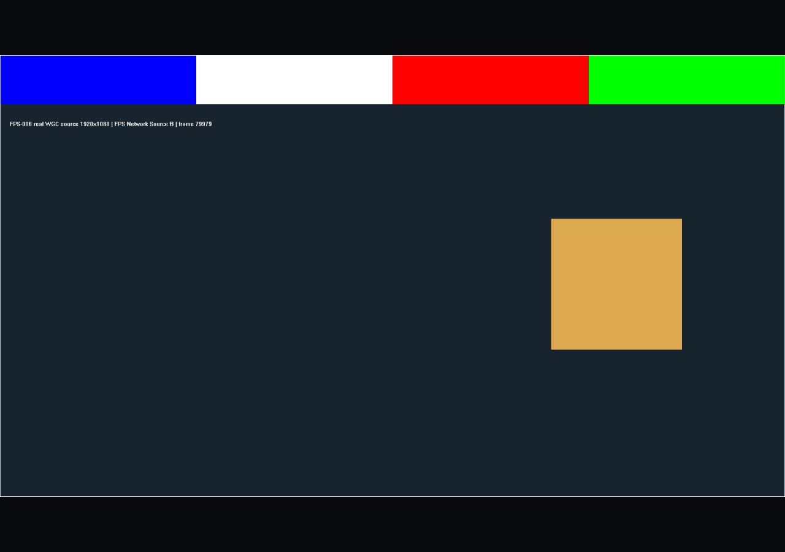
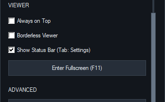

# Peer Ping/FPS and clean viewer qualification — 2026-10-17

## Result and scope

The status strip now shows correlated application Ping and actual Send/View FPS. Settings → VIEWER → Show Status Bar (Tab: Settings) independently hides the entire strip, including the Settings button, and returns its 30 pixels to the renderer. Tab still opens and closes Settings while the strip is hidden. The choice persists, including across Borderless and F11/Esc transitions; legacy or invalid preferences default to showing the strip.

Qualified on CDQ-P, Windows 10 22H2 build 19045 x64, Core Ultra 5 245K, 14 logical CPUs. Two separate portable folders and persistent paired identities used user-selected UDP ports A8996 → B8997 and B8997 → A8996. No second physical PC, LAN/WAN qualification, firewall/router, trust-store or OS security change is implied. This is scoped localhost/UI evidence, not full V1 completion.

## Source and runtime identities

| Increment | Source commit | Release executable SHA256 |
|---|---|---|
| Before status metrics | c657f6a4ca87487178a1e4eccadcf94c345ecef6 | B1CC600361EAAF1783E9DE4AC66CEC09951544C5DB2E71CBF92F1B7D4A57E7BC |
| Initial metrics candidate | 2cbaaa8f46cd0ac614e6ba66de89105d5a923505 | F6AEF436FD9A3DC38E1AA13ADAA781A36A5749FCEE619EF197A11D684960A7B5 |
| Status bounds correction | 30b24979d17faae0e35e5d79c8e4c0fde43a6f26 | E7DD5B14F94B3CEC7E2D87EB6E0E4064FBB14150A74EC71B3BA67221912EA43C |
| Persisted viewer visibility | 2c0b71761f3a715a9d9dafd54872f7336f763be7 | 89D55654B298F975C89B4063C6B4BDCC4D60E8003C7C2661CD06437E74B09C81 |

Final product sources passed all-target Release and Debug builds and full CTest. Documentation is committed separately. GitHub Actions must match the delivery commit exactly; the post-push run/result is retained with the local delivery evidence.

## Measurement semantics

- Ping reuses the existing authenticated, session-bound 1 Hz Ping/Pong. Only a matching outstanding, fresh Pong is accepted; duplicates, wrong sessions and older replies do not replace newer data. Outstanding samples are bounded to four. Displayed RTT expires after 3 seconds and clears on disconnect. No ICMP or extra probe traffic is introduced.
- Ping is application control round-trip time, including scheduling/service time. It is neither one-way video latency nor ICMP latency. A zero tick difference displays less than 1 ms because of timer resolution.
- Send FPS counts successful handoff into the existing bounded sender queue. View FPS counts successful renderer-sink deliveries. They are measured deltas over elapsed time, not the configured target or a packet count.
- Rates update on the existing UI service cadence, at intervals of at least one second. Warm-up, stop, new session/generation, counter rollback, backward time or a gap over five seconds resets the relevant rate to unavailable. Independent directions reset independently. Active delivery with no new frames can show 0.0; a stopped stream shows an em dash.
- Metrics are transient. The status string avoids repeated unchanged writes; ellipsis ends before the Settings button. There is no new timer or per-frame Win32 text update. Hiding the strip changes presentation only.

## Short resource comparison

Workload: two owned moving WGC 1920×1080@60 fixtures; two portable applications; GPU H.264 both directions; No Audio; diagnostic counters enabled equally. Samples ran sequentially for 60 seconds with no concurrent build or UI actions. Process CPU was normalized by 14 logical processors. Frame-rate intervals below use actual counter-log time, approximately 59–60 seconds.

| Run / role | Mean whole-machine CPU % | Peak working set MiB | Send / View FPS | Video drops | Recoveries | Generations unchanged |
|---|---:|---:|---|---:|---:|---|
| Before / A | 1.292 | 241.22 | 58.40 / 57.57 | 0 | 0 | yes |
| Before / B | 1.712 | 240.71 | 57.63 / 58.47 | 0 | 0 | yes |
| Initial candidate / A | 1.282 | 255.57 | 58.37 / 58.33 | 0 | 0 | no |
| Initial candidate / B | 1.331 | 303.01 | 58.33 / 58.37 | 0 | 2 | no |
| Corrected status / A | 1.369 | 230.07 | 59.95 / 59.97 | 0 | 0 | yes |
| Corrected status / B | 1.271 | 230.21 | 59.95 / 59.95 | 0 | 0 | yes |

Combined CPU was about 3.00% before and 2.64% for the corrected-status run. This short uncontrolled comparison does not show a clear added CPU cost; it cannot establish CPU savings, an exact zero overhead, a stable memory delta or long-run video stability. The initial candidate failed strict generation continuity and its two receiver recoveries are retained. The later 60-second pass does not resolve earlier intermittent video recovery or attribute it to status metrics. Resource measurements predate the small viewer-checkbox increment; the final viewer binary received actual functional/UI testing, not another performance claim.

## Verification and review

| Check | Evidence / observed result |
|---|---|
| Metrics runtime RED → GREEN | proc-390 named RTT/rate/format assertions failed; proc-391 full Release 3/3 passed; proc-392 full Debug 3/3 passed |
| Status bounds RED → GREEN | Single bounded review found the status width extending behind Settings. Native tests failed at 640/1280 in proc-395; correction and full Release/Debug 3/3 passed in proc-396 |
| Real metrics UI | proc-399: 7/7 checks: both apps show measured values; 640/1280 status bounds; independent direction stop; idle retains Ping; disconnect clears old values |
| Visibility runtime RED → GREEN | proc-400 compiled successfully then failed new config/full-view assertions as intended; proc-401 all-target Release and Debug builds plus CTest 3/3 each passed |
| Final real viewer | proc-402: 14/14 checks, including live Ping/FPS on both apps, entire-strip hiding in bordered/borderless windows, full-client render bounds, Tab recovery, F11/Esc, off/on persistence and relaunch |
| Visible narrow UI | The actual Viewer checkbox was scrolled into view and captured at 640 px window width; label and control remain inside the panel |
| Review scope | Metrics: one bounded review and one grouped Minor bounds correction, no Critical/Important. Viewer: one fresh read-only review of 30b2497..2c0b717, no actionable findings. No repeat review loop |
| Painting regressions | Existing Hide Settings color, unchanged status/codec controls and Diagnostics opaque-background/repaint checks remain in the passing full native suite |
| Cleanup | All owned A/B apps, relaunched screenshot app and both fixture processes closed gracefully. Zero owned apps/helpers and zero UDP8996/8997 listeners remained. No forced termination in the viewer run |

Native build commands: CMake --build build --config Release or Debug --parallel 4, then CTest --test-dir build -C the matching configuration --output-on-failure. Raw sessions, JSON, scripts, original imperfect screenshot attempt and review notes remain in the ignored .superpowers/sdd/2026-10-17-peer-status-metrics directory. Private identity/trust material is neither copied into public evidence nor changed by these tests.

Owned portable settings were restored to visible Settings/status and bordered windows after the test, while retaining the requested A8996/B8997 ports. Main, sibling worktrees, tags and releases are untouched.

## Next authorized work

The user asked to continue network development after this increment. Resume the approved secure-dual-instance plan at Task 6's remaining comparison: identical encoded workload over QUIC and encrypted TLS/TCP with interleaved control and scheduled audio load, then evidenced self-LAN. The existing native audio report remains authoritative for physical local audio/output qualification.

FPS-009 transport selection stays provisional. DG-001/006/008, Direct Internet/Tailscale/physical second-PC evidence, remote clock alignment, broader recovery/audio fidelity and installer/V1 acceptance remain open.
